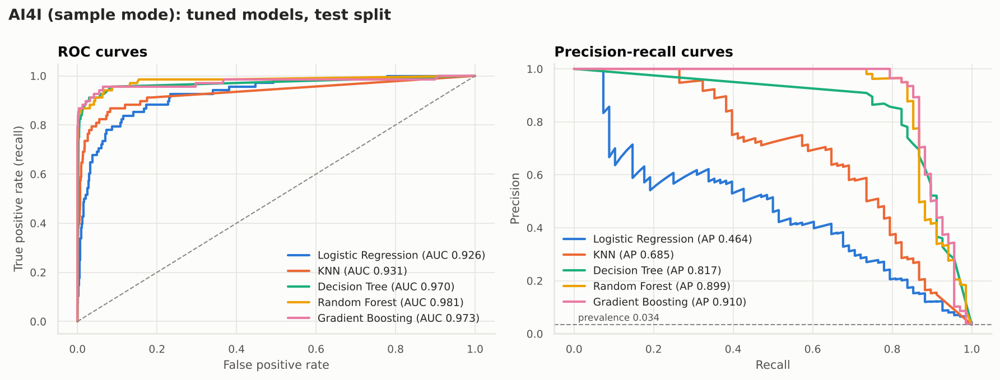
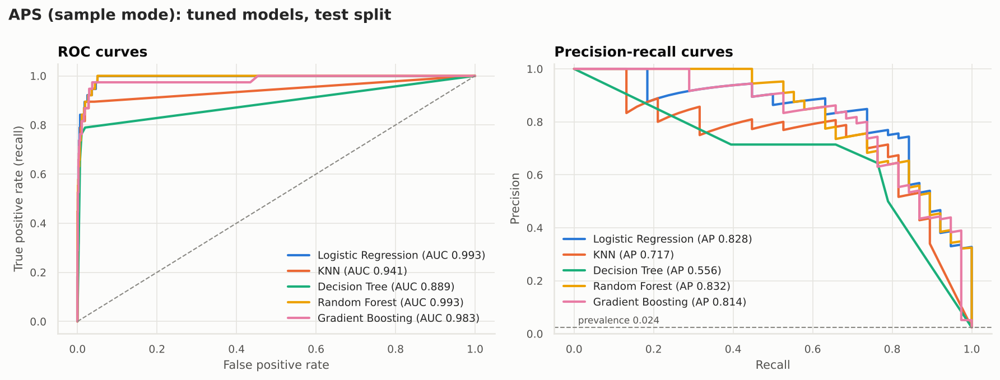

# Run summary — sample mode

Test-split metrics. `baseline` = default hyperparameters, no imbalance handling, threshold 0.5. `tuned` = best imbalance strategy + RandomizedSearchCV, threshold chosen on OOF training predictions (AI4I: max F1; APS: min cost 10*FP + 500*FN). Higher is better for all metrics except FP, FN and cost.

**Sample mode is a functionality check** (APS: 5%/10% stratified subsample; 3-fold CV; 4 search iterations per model). Conclusions about model quality rest on results/full/.

## AI4I — test split: 2000 rows, 68 positives

| algorithm           | variant   |   threshold |   precision |   recall |    f1 |   pr_auc |   roc_auc |   fp |   fn |
|:--------------------|:----------|------------:|------------:|---------:|------:|---------:|----------:|-----:|-----:|
| Decision Tree       | baseline  |       0.5   |       0.786 |    0.809 | 0.797 |    0.642 |     0.901 |   15 |   13 |
| Decision Tree       | tuned     |       0.955 |       0.869 |    0.779 | 0.822 |    0.817 |     0.97  |    8 |   15 |
| Gradient Boosting   | baseline  |       0.5   |       1     |    0.794 | 0.885 |    0.901 |     0.971 |    0 |   14 |
| Gradient Boosting   | tuned     |       0.445 |       0.966 |    0.824 | 0.889 |    0.91  |     0.973 |    2 |   12 |
| KNN                 | baseline  |       0.5   |       0.875 |    0.309 | 0.457 |    0.531 |     0.883 |    3 |   47 |
| KNN                 | tuned     |       0.185 |       0.639 |    0.676 | 0.657 |    0.685 |     0.931 |   26 |   22 |
| Logistic Regression | baseline  |       0.5   |       0.571 |    0.176 | 0.27  |    0.464 |     0.926 |    9 |   56 |
| Logistic Regression | tuned     |       0.24  |       0.525 |    0.471 | 0.496 |    0.464 |     0.926 |   29 |   36 |
| Random Forest       | baseline  |       0.5   |       0.964 |    0.794 | 0.871 |    0.886 |     0.967 |    2 |   14 |
| Random Forest       | tuned     |       0.44  |       0.965 |    0.809 | 0.88  |    0.899 |     0.981 |    2 |   13 |

Model selected on cross-validation (before test scoring): **Random Forest**, strategy `none`, threshold 0.44.

## APS — test split: 1600 rows, 38 positives

| algorithm           | variant   |   threshold |   precision |   recall |    f1 |   pr_auc |   roc_auc |   fp |   fn |   cost |
|:--------------------|:----------|------------:|------------:|---------:|------:|---------:|----------:|-----:|-----:|-------:|
| Decision Tree       | baseline  |       0.5   |       0.794 |    0.711 | 0.75  |    0.571 |     0.853 |    7 |   11 |   5570 |
| Decision Tree       | tuned     |       0.05  |       0.5   |    0.789 | 0.612 |    0.556 |     0.889 |   30 |    8 |   4300 |
| Gradient Boosting   | baseline  |       0.5   |       0.686 |    0.632 | 0.658 |    0.735 |     0.986 |   11 |   14 |   7110 |
| Gradient Boosting   | tuned     |       0.002 |       0.282 |    0.974 | 0.438 |    0.814 |     0.983 |   94 |    1 |   1440 |
| KNN                 | baseline  |       0.5   |       0.929 |    0.342 | 0.5   |    0.638 |     0.891 |    1 |   25 |  12510 |
| KNN                 | tuned     |       0.085 |       0.646 |    0.816 | 0.721 |    0.717 |     0.941 |   17 |    7 |   3670 |
| Logistic Regression | baseline  |       0.5   |       0.771 |    0.711 | 0.74  |    0.831 |     0.99  |    8 |   11 |   5580 |
| Logistic Regression | tuned     |       0.015 |       0.311 |    1     | 0.475 |    0.828 |     0.993 |   84 |    0 |    840 |
| Random Forest       | baseline  |       0.5   |       0.9   |    0.711 | 0.794 |    0.834 |     0.98  |    3 |   11 |   5530 |
| Random Forest       | tuned     |       0.095 |       0.455 |    0.921 | 0.609 |    0.832 |     0.993 |   42 |    3 |   1920 |

Model selected on cross-validation (before test scoring): **Random Forest**, strategy `none`, threshold 0.095.

